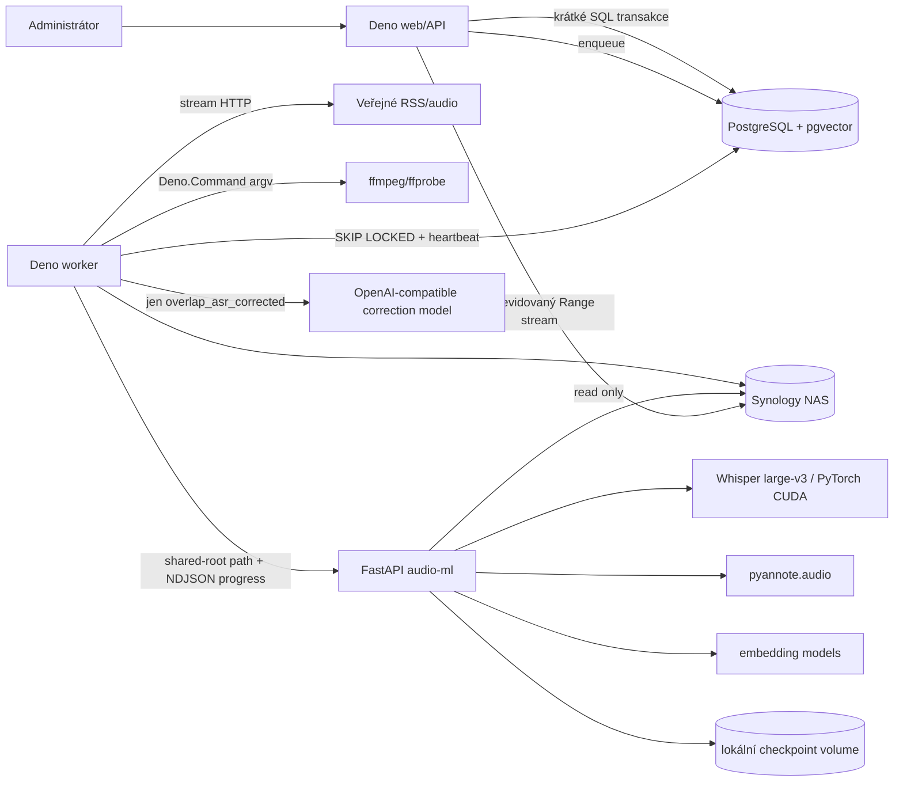

# Architektura

## Hranice a datový tok



Deno vlastní HTTP, validaci přes Zod, SQL, stavový automat, frontu, retry, souborové cesty a
orchestraci. Python nevytváří aplikační záznamy ani jobs; načítá pouze normalizované audio uvnitř
povoleného shared rootu a vrací verzovaný ML kontrakt.

Osoba je globální entita, ale její příslušnost a role jsou v M:N tabulce `podcast_persons`. Jedna
osoba tak může být moderátorem jednoho podcastu a hostem jiného. Vazba dovoluje právě role
`moderator` a `guest`; výběry mluvčích i hlasový matching vždy vycházejí jen z vazeb aktuálního
podcastu. `episode_participants` dál zachycuje účast v konkrétní epizodě.

V odděleném režimu běží Deno a PostgreSQL lokálně a FastAPI na DGX Spark. Obě strany připojují
stejný Synology SMB share jako `/data`; lokální aplikace read/write, ML kontejner read-only. HTTP ML
rozhraní vyžaduje bearer token. Spark nezná databázové přihlašovací údaje a nemůže zapisovat do
podcastového storage. Rozpracované Whisper chunky zapisuje pouze do odděleného lokálního volume na
DGX; podpis audia a ID jobu brání jejich použití pro jiný běh.

## Pipeline

`DOWNLOAD_AUDIO → NORMALIZE_AUDIO → PROCESS_AUDIO_ML → IDENTIFY_SPEAKERS →
CREATE_CONTENT_CHUNKS → CREATE_TEXT_EMBEDDINGS`.

V `PROCESS_AUDIO_ML` zůstávají Whisper, pyannote i speaker attribution společnou cestou. Pouze režim
`overlap_asr_corrected` za ně skládá korekční post-processing před uložením processing runu. Korekce
pracují inkrementálně s překrývajícím se časovým kontextem a nikdy nemění jiné pole než text cílové
promluvy; běžné režimy correction provider vůbec nevolají.

`IDENTIFY_SPEAKERS` nejprve proti ověřeným hlasovým referencím stejného podcastu automaticky přiřadí
pouze dostatečně jisté stálé moderátory. Pokud potom zůstává právě jeden neznámý hlas, lokální
Answer model smí z názvu a popisku vybrat jediného explicitně uvedeného hosta. Vysoká jistota modelu
nestačí sama: vrácené jméno musí být skutečně přítomné v metadatech a nesmí odpovídat už
rozpoznanému moderátorovi. Při více neznámých hlasech se metadata nepoužijí.

Hlasový cluster lze v konkrétním processing runu označit stavem `ignored`. Ignorovaný cluster dál
zůstává součástí přepisu a chunků, ale nepočítá se do workflow nevyřešených hlasů a automatická
identifikace jej přeskočí. Ignorování odstraní clusterové přiřazení a zneplatní hlasovou referenci;
ruční override jednotlivé promluvy se zachová. Obnovení vrátí cluster do stavu `unknown`.

Web pouze enqueueuje první chybějící krok. Worker claimuje řádek atomicky přes
`FOR UPDATE SKIP LOCKED`, drží heartbeat a po úspěchu enqueueuje další krok. Handlery znovu
používají validní soubory/processing run nebo transakčně nahrazují odvozený výsledek. Selhání
nastaví epizodu na `failed`; „Opakovat“ vybere krok podle existujících artefaktů.

Rozdělení je logické, nikoli databázové: download sloty claimují jen `DOWNLOAD_AUDIO`, zatímco
processing sloty claimují zbývající typy. Obě fronty sdílejí historii, retry, heartbeat a stavové
API v jedné tabulce `jobs`.

Per-podcast autopilot je periodický scheduler uvnitř workeru. Pod transakčním PostgreSQL advisory
lockem nejprve ověří, že neexistuje žádný aktivní processing job; nízkoprioritní hromadné
`DOWNLOAD_AUDIO` s `continuePipeline=false` přitom ignoruje. Potom vloží první krok nejnovější
vhodné epizody a upřednostní už stažené audio. Zámek zachovává globální limit jedné automaticky
rozpracované pipeline i při více worker procesech; samotné kontrolní tick-y se do `jobs` neukládají.

Stejný worker periodicky plánuje také per-podcast denní obnovu RSS. Samostatný advisory lock vybere
nejstarší povolený feed, který nebyl úspěšně načten ani naplánován v posledních 24 hodinách, a vloží
nízkoprioritní `IMPORT_FEED`. Handler používá stejný idempotentní import jako ruční aktualizace.

Samostatná volba `auto_download_enabled` (výchozí vypnuto) při importu RSS atomicky zařadí pouze
nově vložené epizody do download fronty s `continuePipeline=false` a `source=bulk_prefetch`. Zapnutí
nestahuje historické ani znovu nalezené epizody. Pravidelnou kontrolu RSS nadále řídí
`auto_refresh_enabled`; přepis řídí automatické zpracování. Nastavení ukládá
`PATCH /api/podcasts/:id/auto-download` s JSON `{ "enabled": true }`. Počítadlo „ve frontě / běží“
nezahrnuje epizody ve stavu `downloaded`.

## Processing runs a storage

Každý ML běh má `processing_runs`. Epizoda ukazuje přes `active_processing_run_id` na jediný aktivní
výsledek, takže se nemíchají modelové verze. Cesta je vždy sestavena serverem:

```text
storage/podcasts/{podcastId}/episodes/{episodeId}/
  original/audio.*
  normalized/audio.wav
  derived/transcript-{run}.json
```

Klient nikdy neposílá filesystem cestu. Audio endpoint načte cestu z databáze, ověří containment a
podporuje jednu HTTP Range.

Epizoda cacheuje skutečnou velikost svého storage adresáře rozdělenou na audio (originál a
normalizovaná kopie), transcript JSON a ostatní soubory. Worker ji obnoví po každém jobu a pod
zámkem řádku podcastu přepočítá součet. UI tak neprochází NAS při každém načtení stránky.

## Retrieval a RAG

Chunky mají přibližně 140 slov, zachovávají celé utterances a vazební tabulka zajišťuje přesný filtr
osoby. Hybrid vybere kandidáty pomocí fulltextu a cosine similarity nad BGE-M3, poté je znovu seřadí
multilingual cross-encoderem. Obecná slova požadavku jako „citace“ neblokují lexikální kandidáty a
UI nabízí přísný, vyvážený a širší práh relevance. `/api/ask` vrací strukturované zdroje; bez
generativního provideru odpověď negeneruje, aby endpoint nehalucinoval. Volitelný
`openai-compatible` Answer provider posílá otázku a nejvýše osm dohledaných úryvků do odděleného
model serveru. Odpověď musí být validní JSON, smí odkazovat jen na předané `sourceId` a při chybě se
endpoint bezpečně vrátí k samotným zdrojům. Výchozí stav provideru je `disabled`.

## Bezpečnost

Externí JSON validuje Zod/Pydantic, SQL je parametrizované, ffmpeg nepoužívá shell a ML cesta musí
být uvnitř read-only shared rootu. Strukturované logy filtrují klíče/tokeny/embeddingy. Speaker
embeddingy jsou biometricky citlivé a nejsou vystavené veřejným read endpointem. `AUTH_MODE=header`
poskytuje minimální nahraditelnou auth boundary pro mutace.
