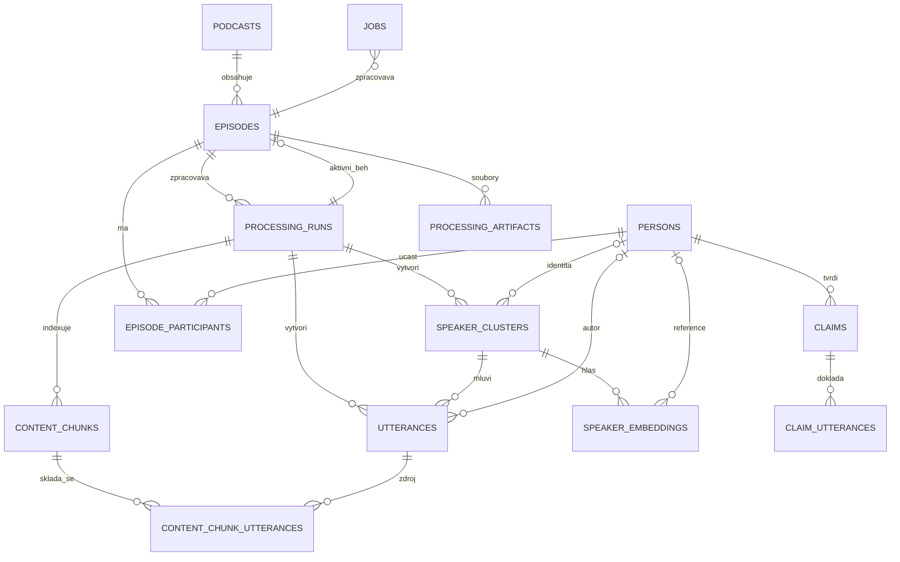

# Datový model

UUID jsou primární klíče, časy jsou `TIMESTAMPTZ`, audio pozice `DOUBLE PRECISION`. `rss_url` a
`(podcast_id, external_id)` zajišťují idempotentní import. Ruční identita není odvozena z
`SPEAKER_00`; propíše se až potvrzením do clusteru i utterances.

Epizoda drží také `is_present_in_feed`, `last_seen_in_feed_at` a `missing_from_feed_since`. Obnova
feedu je prováděna transakčně: nalezené položky označí jako aktuální, chybějící pouze jako mimo RSS.
Řádek epizody, stažené audio, přepis ani index se při zmizení položky z RSS nemažou.

Fulltext používá uložený generated `tsvector` s konfigurací `simple`. Textové embeddingy mají 1024
rozměrů pro BGE-M3; hlasové 256 pro zvolený WeSpeaker model. Změna modelové rodiny vyžaduje migraci,
ne tiché oříznutí.

`processing_runs.transcript_alignment_mode` uchovává přesnou zvolenou variantu včetně
`overlap_asr_corrected`; `asr_correction_metadata` drží model, práh, počty
návrhů/aplikací/odmítnutí, selhání, dobu a dostupnou token usage. Pouze korigovaný režim vyplňuje u
promluvy `raw_text` a `asr_corrections`; běžné `text` obsahuje zobrazenou korigovanou variantu.
Auditní JSON uchovává i návrhy pod prahem nebo odmítnuté kvůli nejednoznačnému či kolidujícímu
rozsahu, takže změnu lze vyhodnotit nebo vrátit bez ztráty Whisper výstupu.

`jobs` má parciální index pro queued/running výběr a parciální unikátní index, který brání dvěma
aktivním jobům stejného typu nad jednou entitou. Sloupce `progress_*` drží fázi, čítač, celkové
procento, popis a čas poslední aktualizace.
